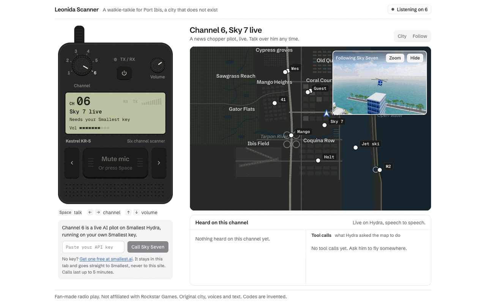
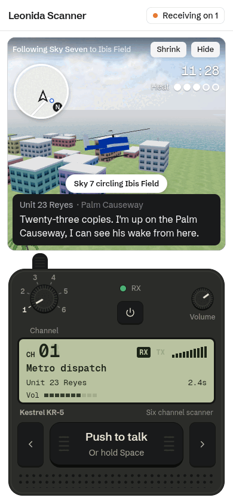
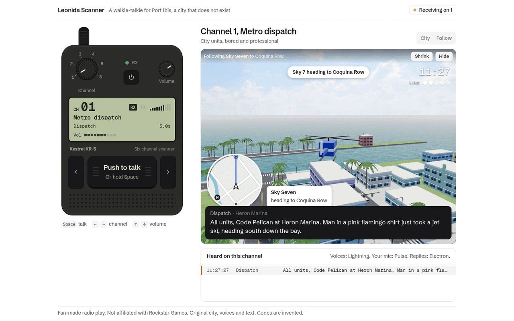
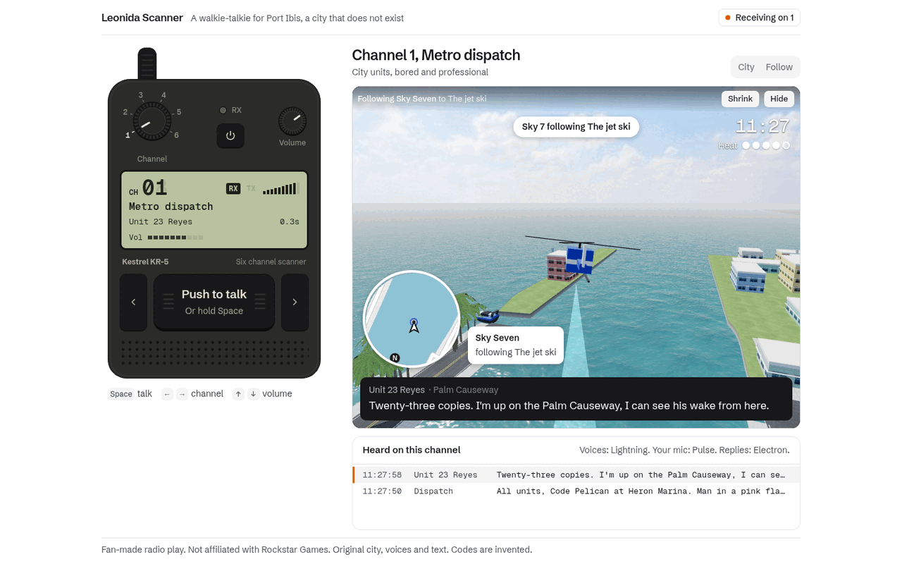

# Leonida Scanner

A walkie-talkie for a made-up sun-belt city in the browser. Six radio channels: five of AI radio chatter you can talk back to, and one live news chopper pilot on [Hydra](https://docs.smallest.ai/models/speech-to-speech/overview) who flies where you tell him.

**Live demo:** https://leonida-scanner.vercel.app (channel 6 runs on your own Smallest API key)

Fan-made radio play. Not affiliated with Rockstar Games. The city, districts, streets, units, voices and codes are all original. No game logos, fonts, map imagery, footage, characters or soundtrack.

## Features

- **Channel 6, a live Hydra pilot**: one speech-to-speech session, full duplex. Talk any time, talk over him and he stops (barge-in).
- **Hydra tool calling**: the pilot flies the chopper with five tools (`fly_to`, `follow`, `circle`, `spotlight`, `report`). Places are matched against the city's own map, so an unknown street comes back as "unknown place" with the nearest real one as a suggestion.
- **Tool calls on screen**: on desktop, channel 6 lists every tool call next to the log, with its arguments and the result sent back to Hydra.
- **Channels 1 to 5**: scripted radio chatter voiced by 15 Lightning v3.1 Pro voices, each channel on its own clock, so you tune in mid-sentence like a real scanner.
- **Push-to-talk on 1 to 5**: your words go through Pulse, Electron writes an in-character reply, and Lightning voices it on the channel.
- **2D map and 3D chase view**: units move as the story moves. All 3D assets are CC0 or made in code (see [ASSETS.md](./ASSETS.md)).
- **Python standard library only** on the server. The UI is pre-built, so no Node is needed to run it.

## Demo

**Desktop, channel 6:** the key box under the radio, and the tool-call column next to the log.



<table>
<tr>
<td width="32%"></td>
<td><br></td>
</tr>
<tr>
<td>Phone layout (9:16)</td>
<td>Zoomed 3D view, and Sky 7 tailing the jet ski with the spotlight on</td>
</tr>
</table>

## Requirements

No packages to install: the server uses only the Python standard library (3.10 or newer).

- Add `SMALLEST_API_KEY` to your `.env` (copy [`.env.sample`](./.env.sample)). Get a key at [app.smallest.ai](https://app.smallest.ai/?utm_source=cookbook&utm_medium=github&utm_campaign=leonida-scanner).
- Chrome or Edge, a microphone, and headphones for channel 6 (its mic is always open).

## Usage

```bash
cd speech-to-speech/leonida-scanner
cp .env.sample .env        # then put your key in it
uv run --env-file .env server.py
```

Open [http://127.0.0.1:8787](http://127.0.0.1:8787), press **Turn on radio**, and allow the microphone. Flip channels with the left and right arrow keys or the knob. Hold **Space** (or the big button) to talk on channels 1 to 5. On channel 6 just talk. Port taken? Set `PORT=8790`.

Without uv: `export SMALLEST_API_KEY=...` then `./run.sh` (or `python3 server.py`).

What your key is used for:
- **First start**: the 32 scripted channel lines are generated once with Lightning (about 20 seconds, in the background) and cached in `.cache-tts/`. After that, channels 1 to 5 cost nothing. `PREWARM=0` skips this and generates each line the first time its channel is tuned.
- **Push-to-talk on channels 1 to 5**: one Pulse call, one Electron call, and two or three short Lightning lines.
- **Channel 6**: a live Hydra session, up to five minutes each time you tune in.

### Hosting it for other people

Set `LIVE_MODE=byok` so channel 6 runs on each visitor's own key instead of yours. Tuning to channel 6 then shows a field for the visitor's Smallest API key, with a link to get one. The browser keeps the key in that tab's `sessionStorage` and opens the Hydra socket with it directly. The server only serves the session config from `GET /api/live/session` and refuses `POST /api/live/token`. Channels 1 to 5 still run on `SMALLEST_API_KEY`.

Without `LIVE_MODE`, the server mints a 60-second token (`POST https://api.smallest.ai/console/v1/auth/token`) for each channel 6 session, so the real key never reaches the browser. Caps for that mode are at the top of `live.py`.

## Recommended Usage

- Learn Hydra's realtime protocol end to end: session config, streaming mic audio, barge-in, and function calls answered with `function_call_output`.
- Use the tool pattern for any agent that acts on a world: resolve the model's free-text arguments against your own data and return a suggestion instead of failing silently.
- For a minimal Hydra client without the game, see [Python Quickstart](../python-quickstart/).

## Key Snippets

A Hydra tool call, answered in the browser (`web/src/lib/scanner/live.svelte.ts`):

```ts
case 'response.function_call_arguments.done':
	this.runTool(String(evt.name ?? ''), String(evt.call_id ?? ''), String(evt.arguments ?? '{}'));
	break;

// runTool: run it against the map, send the result back, then ask for the next response
this.send({
	type: 'conversation.item.create',
	item: { type: 'function_call_output', call_id: callId, output: JSON.stringify(result) }
});
this.send({ type: 'response.create' });
```

One of the pilot's tools (`live.py`):

```python
{
    "type": "function",
    "name": "fly_to",
    "description": (
        "Fly the Sky Seven chopper to a place, street or area and hover over it. Call it every time "
        "the caller asks you to go, fly, head, swing over, check out or look at somewhere, before you answer."
    ),
    "parameters": {
        "type": "object",
        "properties": {"place": {"type": "string", "description": where}},
        "required": ["place"],
    },
}
```

## Channels

| Ch | Name | Who is on it | Voices (Lightning v3.1 Pro) |
| --- | --- | --- | --- |
| 1 | Metro dispatch | Dispatch, Unit 23 Reyes, Unit 14 Peck, Sergeant Holt. The jet ski chase, a stalled coupe, a loose peacock. | kaitlyn, blake, austin, zoe |
| 2 | Harbor patrol | Harbor base, Marine Two, Tower Four lifeguard. The same jet ski from the water, and a man fishing with a hot dog. | chelsea, hunter, dean |
| 3 | Sky 7 news | A news chopper pilot and an impatient studio producer. Mango seller at the interchange, then the jet ski. | brooks, kennedy |
| 4 | Sunrise cabs | Cab base, Cab 41, Cab 9. A wedding guest late for Ibis Field. | kimberly, tucker, piper |
| 5 | Citizens band 19 | Big Wes the trucker, Mango Mama from Gator Flats, Night Owl with theories. | wesley, molly, winston |
| 6 | Sky 7 live | The news chopper pilot, live on Hydra. You talk to him. | One Hydra voice per session |

Fifteen speakers, fifteen different voices. The jet ski story runs across channels 1, 2, 3 and 5, so flipping channels shows the same event from different seats. Codes such as "Code Pelican" and "Status Tangerine" are invented on purpose. No real police ten-codes.

## How It Works

**Channel simulation.** Each channel is a loop of real Lightning clips with gaps, on its own clock that starts when you turn the radio on. Tuning in works out where that channel is right now and starts playback from that exact point, so you can land mid-sentence like a real scanner. Channels you are not listening to keep running. Channel 1 starts one second before the marina call, so the first thing you hear is the hook. Loops run 43 to 61 seconds.

**Radio sound.** All of it is made in the browser from the real clips: high-pass and low-pass band, a presence peak, soft clipping and compression, an open-carrier hiss while someone is transmitting, a squelch burst on key-up, a short roger tone and squelch tail at the end, a detent click on every knob step, and a static sweep on channel change. The LCD level meter and LED are driven by analysers on the real audio (incoming voice, or your mic while you transmit).

**Push-to-talk.** Key-down plays a chirp, stops whatever is playing, freezes that channel's clock, and records your mic (16 kHz mono WAV, 20 second cap). Release sends the clip to Pulse. Your words appear in the log exactly as heard. Electron writes two or three in-character lines from the speakers on that channel, with a place id from the city. Lightning voices each line with that speaker's voice, and they play on that channel. Then the loop resumes from where it was frozen. If you switch away while a reply is being made, it waits on that channel until you come back. If Electron fails, the server uses a short canned reply for that channel and the log says "canned fallback".

**Map.** Port Ibis is drawn by hand as SVG in `web/src/lib/components/map/geometry.ts`: a barrier island with the Flamingo Strip beach, Heron Bay, Heron Marina, the Palm Causeway bridge, Sandbar Inlet, the Coral Court downtown grid with Banyan Park, Mango Heights, Coquina Row, the Old Quay port, the Seagrape Expressway with the Cypress Toll and the Orange Grove Interchange, the Sawgrass Reach and Gator Flats swamp, and Ibis Field airport. Units on the tuned channel are markers (circles move, squares are fixed bases). The unit talking gets an orange ring, the place it is talking about pulses with a name chip, mobile units drive to new places as the story moves, and channels 1 to 3 show the jet ski's route through the bay. "You" is the blue-outlined arrow near Banyan Park, and it pulses while you transmit. **City** shows the whole city. **Follow** zooms in and pans to each transmission (default on narrow windows).

**Layouts.** At 1280 x 800: radio on the left, map and the channel log on the right, with real timings for the last reply (Pulse, Electron, Lightning seconds). At about 430 x 900 (9:16): map on top, radio on the bottom half, captions on the map.

## What It Calls, and When

All calls go from `server.py` to `https://api.smallest.ai/waves/v1`. The browser only talks to `127.0.0.1`.

| When | API | Endpoint in this app |
| --- | --- | --- |
| Server start (once, only lines not cached) and first tune of a channel | Lightning `lightning_v3.1_pro` TTS | `GET /api/line?ch=&i=` (server-owned text only) |
| You release push-to-talk | Pulse STT | `POST /api/stt` |
| Right after Pulse | Electron chat completion | `POST /api/reply` |
| Right after Electron, once per reply line | Lightning TTS (cached by voice and text) | `POST /api/tts` (speaker must belong to the channel) |

Cost of a normal take after the first run: one Pulse call, one Electron call, two or three short Lightning calls per push-to-talk. Channel chatter costs nothing after it is cached.

## Security

- Binds `127.0.0.1` only. `Host` must be `127.0.0.1:<port>` or `localhost:<port>`. `Origin`, when present, must match; every POST must carry our Origin.
- Key read from `SMALLEST_API_KEY` only, never sent to the browser, never logged. With `LIVE_MODE=byok` the visitor's own key goes from their tab straight to `wss://api.smallest.ai` and is never sent to this server. Request logs show method, path and status only. Upstream error snippets are trimmed and anything that looks like a key is redacted.
- CSP on the page: `default-src 'none'`, scripts from self plus a sha256 hash of SvelteKit's inline bootstrap (no `'unsafe-inline'` for scripts), `connect-src 'self' blob: wss://api.smallest.ai`, `frame-ancestors 'none'`. Plus `X-Frame-Options: DENY`, `nosniff`, `no-referrer`, COOP/CORP same-origin, and `Permissions-Policy: microphone=(self)`.
- Static files are served from `static/` only, with traversal and NUL checks. Request bodies are size-capped (32 KB JSON, 3 MB audio), content types are enforced, the STT body must be a WAV, and each API path is rate limited.
- TTS only accepts the 15 known voices, through a speaker id that belongs to the channel.

## Structure

```
leonida-scanner/
├── server.py          # local server and Smallest API proxy, standard library only
├── live.py            # channel 6: Hydra session config, tools, token minting, caps
├── sky.py             # resolves the pilot's place and unit words against the map
├── channels.py        # channels 1 to 5: speakers, voices, scripts, places (data only)
├── static/            # pre-built UI (rebuild from web/)
├── web/               # SvelteKit source: audio engine, channel clock, radio, map, 3D view
├── tests/             # offline tests (pytest), plus node parity tests for the browser code
├── tools/             # hydra_probe.py: headless Hydra check
├── smoke_test.py      # live check: one Lightning line, one Pulse pass, one Electron reply
└── ASSETS.md          # every 3D model, its source and license
```

## Rebuild the UI (only if you change `web/`)

```bash
cd web && npm ci && npm run check && npm run build   # writes ../static
```

## Checks

```bash
uv run --with pytest python -m pytest tests -q
uv run --env-file .env smoke_test.py      # spends one Pulse and one Electron call
```

## Documentation

- [Hydra speech-to-speech](https://docs.smallest.ai/models/speech-to-speech/overview)
- [Lightning text-to-speech](https://docs.smallest.ai/models/text-to-speech/overview)
- [Pulse speech-to-text](https://docs.smallest.ai/models/speech-to-text/overview)

## Next Steps

- [Hydra Realtime Demo](../hydra-realtime-demo/): Next.js Hydra client with multi-agent presets and a wire log of every frame.
- [Python Quickstart](../python-quickstart/): the smallest possible Hydra client.
